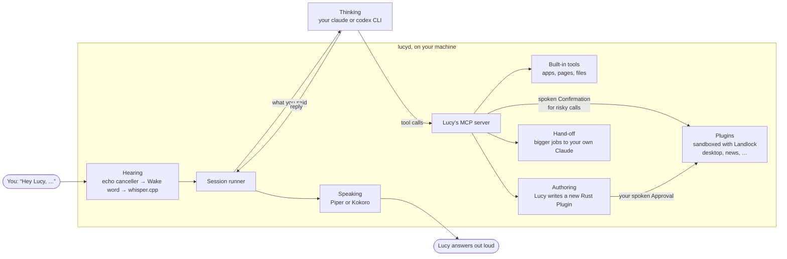

# Lucy

[](https://youtu.be/fcCv_0X4S8k)

*Click the image above to watch a video all about Lucy.*

Lucy is a voice assistant for the Linux desktop. Say "Hey Lucy" and talk to her: she answers out loud, opens apps and pages, finds your files, manages your windows, reads you the news, and passes bigger jobs to your own Claude. When she can't do something yet, she can write a new Plugin for it, and she asks you before using it.

Lucy runs on your own machine and uses what you already have:

- **Thinking** goes through the `claude` or `codex` CLI you're already logged in to, on your existing subscription. Lucy never asks for an API key and never adds a per-use bill.
- **Hearing** is local: [whisper.cpp](https://github.com/ggml-org/whisper.cpp) turns speech into text on your CPU or GPU, and the Wake word is detected on your machine.
- **Speaking** is local too, through [Piper](https://github.com/OHF-Voice/piper1-gpl) or [Kokoro](https://github.com/thewh1teagle/kokoro-onnx).
- **Plugins** run in a sandbox, and each one needs your spoken Approval before Lucy uses it.

> **Status: v0.1, early.** Lucy is developed and tested on [Omarchy](https://omarchy.org) (Arch Linux with Hyprland). The core works on other Linux desktops with PipeWire, but the window-management Plugin, the on-screen Indicator and the bar panel need Omarchy or a wlroots-style Wayland compositor.

## How it works



1. Lucy listens all the time on your machine, and nothing leaves it until she hears the Wake word. Then whisper.cpp turns what you say into text.
2. The text goes to the `claude` or `codex` CLI you're already logged in to. Its reply is spoken sentence by sentence, so Lucy starts talking before it has finished.
3. To act, the model calls tools on Lucy's own MCP server: Built-in tools for apps, pages and files, and Plugins for everything else. Lucy asks you out loud before anything risky, and only a clear yes counts.
4. When no Plugin can do what you ask, Lucy can write one in Rust. Before she uses it, you approve it by voice.

## What you need

- **Linux** with a kernel that has [Landlock](https://docs.kernel.org/userspace-api/landlock.html) turned on (Arch's and most current distros' kernels do). Plugins won't run without it.
- **PipeWire** (PulseAudio and ALSA also work, with Barge-in by speech turned off by default).
- A **microphone and speakers**. Headphones work best: Lucy cancels her own echo, but nothing beats not hearing it.
- **systemd** user services, which run Lucy in the background.
- A **thinking CLI**, logged in with a subscription:
  - [Claude Code](https://docs.anthropic.com/en/docs/claude-code) (`claude`), logged in with a claude.ai account, or
  - [Codex](https://github.com/openai/codex) (`codex`), logged in with a ChatGPT account.
- A **keyring** that speaks the Secret Service API (GNOME Keyring or KeePassXC), if a Plugin needs a password or API key.

## Install

There are two ways in: download a release, or build from source. Both end with the same `install.sh`, which puts everything in place, and then `lucy setup`.

### 1. Log in to a thinking CLI

Install Claude Code or Codex if you haven't already, then run it once and log in with your subscription account (not an API key):

```sh
claude      # then /login, and choose your claude.ai account
# or
codex login
```

Lucy checks this before each Session. If `claude` would bill an API key instead of your subscription, she refuses to use it, so a forgotten `ANTHROPIC_API_KEY` can't run up a bill.

### 2a. Install a release

Download the latest `lucy-<version>-x86_64-linux.tar.gz` from the [releases page](https://github.com/froogle/Lucy/releases), then:

```sh
sudo pacman -S --needed pipewire alsa-lib libpulse vulkan-icd-loader uv
tar -xzf lucy-*-x86_64-linux.tar.gz
lucy-*-x86_64-linux/install.sh
```

The libraries are what Lucy runs on; on other distributions, install the same ones under their local names. `uv` is how setup installs her voice.

### 2b. Or build from source

These steps are for Arch Linux and Omarchy. On other distributions, install the same libraries under their local names.

```sh
sudo pacman -S --needed base-devel git rustup cmake clang pkgconf \
    vulkan-headers vulkan-icd-loader shaderc \
    alsa-lib pipewire libpulse jq uv
rustup default stable      # if rustup is new to you

git clone https://github.com/froogle/Lucy.git lucy
cd lucy
scripts/install.sh
```

whisper.cpp is built with Vulkan, so Lucy can use your GPU when there is one. The repository pins its own Rust version in `rust-toolchain.toml`, and `cargo` fetches it the first time you build. The first build takes a while: it compiles whisper.cpp and the audio stack.

From a checkout, `install.sh` first runs `scripts/build.sh`, which builds the programs for release and lays them out as the same bundle a release contains.

### What install.sh does

| What | Where |
|---|---|
| `lucyd` (the daemon), `lucy` (settings, setup, status, service control) and `lucy-indicator` (the on-screen marker) | `~/.local/bin` |
| The Omarchy bar panel | `~/.local/share/lucy/omarchy-plugin` |
| The `lucyd` and `lucy-indicator` systemd user units, not yet turned on | `~/.config/systemd/user` |
| The two Plugins that ship with Lucy, news and Omarchy desktop (asks for `sudo`, only when they changed) | `/usr/share/lucy/plugins` |
| The Whisper speech model: `base.en`, plus `small.en` when you have a GPU (skipped when already there) | `~/.local/share/lucy/models` |

The shipped Plugins live where only root can change them; that is what lets Lucy trust them without asking for an Approval. Set `LUCY_PREFIX` to install somewhere other than `~/.local`. Make sure `~/.local/bin` is on your `PATH`; the script warns you if it isn't.

It also checks that the libraries Lucy needs are there, and warns you when neither `claude` nor `codex` is installed.

### 3. Run setup

On a first install, `install.sh` opens `lucy setup` for you. Otherwise, run it:

```sh
lucy setup
```

Setup walks through each section in turn: the thinking CLI, speech-to-text, Lucy's voice, your microphone and speakers, the Wake word, Plugins and the background service. Press Enter to accept each suggestion. Along the way it installs Piper (or Kokoro) for her voice, lets you hear it, and tests your microphone.

In the last section, **Service**, say yes to starting Lucy at login. That turns on and starts the `lucyd` and `lucy-indicator` systemd user services. On Omarchy it also links the bar panel; add `lucy-panel` to your bar to see it.

### 4. Say hello

Say **"Hey Lucy"**. The first time, she introduces herself and asks what to call you.

The [user guide](docs/user-guide/README.md) explains everything she can do and how to set her up the way you like.

## Updating

Run `install.sh` again, from a newer release or from your checkout after pulling:

```sh
git pull
scripts/install.sh
```

It stops Lucy, installs the new programs (and the shipped Plugins, with `sudo`, only when they changed), starts her again and reloads the bar. From a checkout, cargo rebuilds only what changed.

An install from before these scripts lived in `~/.cargo/bin`. `install.sh` moves it to `~/.local/bin`, removes the old programs so they can't shadow the new ones, and points the services at the new place.

## Uninstalling

```sh
scripts/uninstall.sh       # or uninstall.sh from the release folder
```

It stops and removes the services, the programs, the bar panel and its link, and the shipped Plugins. Lucy's settings, Persona, models and Plugins stay in `~/.config/lucy`, `~/.local/share/lucy` and `~/.local/state/lucy`; delete those too to remove everything. Credentials you entered for Plugins stay in your keyring under Lucy's name.

## Making a release

Bump `version` in `Cargo.toml`'s `[workspace.package]`, commit, then tag and push:

```sh
git tag v0.2.0
git push origin v0.2.0
```

The [Release workflow](.github/workflows/release.yml) builds the bundle with `scripts/build.sh --tarball` and publishes it, with its SHA-256, as a GitHub release. It refuses a tag that doesn't match the version. To make the same tarball locally, run `scripts/build.sh --tarball`; it lands in `target/dist/`.

## Documentation

- **[User guide](docs/user-guide/README.md)**: getting started, talking to Lucy, Plugins, settings, privacy and troubleshooting.
- **[Developer guide](docs/developers/README.md)**: how Lucy is built, how to work on her, and **[how to write a Plugin](docs/developers/writing-a-plugin.md)**.
- **[Glossary](GLOSSARY.md)**: the words Lucy's code and docs use, and what each means.
- **[Decision records](docs/adr/)**: why Lucy is built the way she is.

## Licence

Lucy is dual-licensed under the MIT licence and the Apache License 2.0, at your option. Piper and espeak-ng are GPL-3.0; Lucy runs them as separate programs and never links them ([ADR 0003](docs/adr/0003-permissive-licence-gpl-out-of-process.md)).
